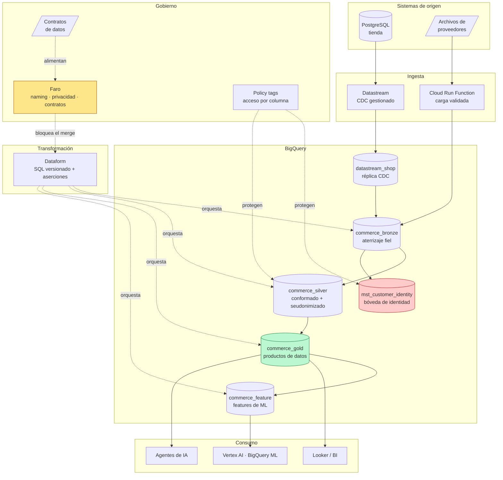
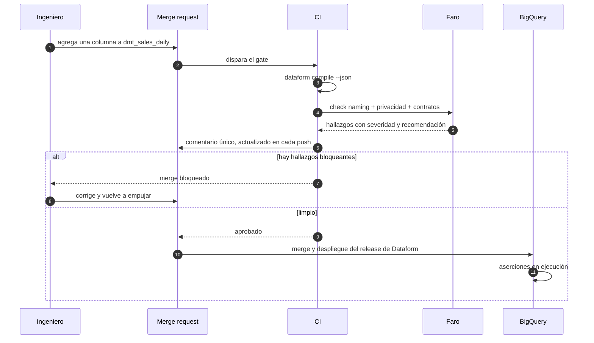

# Arquitectura de referencia

## El diagrama

## Las cinco decisiones que definen todo lo demás

### 1. Medallion, pero con la frontera de privacidad en silver

Bronze, silver, gold es una estructura conocida. Lo que la vuelve un mecanismo de
gobierno y no sólo un orden es **poner la transformación de privacidad exactamente en
el salto de bronze a silver**, y en ningún otro lugar.

Bronze es una copia fiel: los datos personales llegan tal como están en el origen, y
el control es de acceso —sólo el service account del producto lo lee. Silver es donde
las personas se convierten en seudónimos. De ahí hacia arriba, ninguna transformación
tiene que volver a preocuparse del problema: gold y feature heredan la propiedad.

La alternativa —seudonimizar "donde haga falta"— significa que cada modelador toma la
decisión de nuevo, y basta una omisión para perderla. Con la frontera en un solo lugar,
el control se audita revisando un puñado de archivos.

### 2. El dato personal se concentra, no se elimina

Eliminar el dato personal del warehouse es imposible —hay obligaciones legales que
exigen poder responder qué se tiene de una persona— y contraproducente: lo que ocurre
en la práctica es que alguien lo vuelve a traer por un camino lateral.

El patrón es una **bóveda de identidad**:
[`mst_customer_identity`](../products/novamarket-commerce/definitions/silver/mst_customer_identity.sqlx)
es la única tabla con correo, nombre, teléfono y dirección. Lleva policy tags por
columna y su propia lista de acceso. Todo lo demás usa `customer_key`, el seudónimo.

Lo que esto compra:

- El control de acceso se audita mirando una tabla, no el warehouse completo.
- Una solicitud de acceso o supresión se resuelve con una consulta acotada.
- Al borrar a una persona, los seudónimos que quedaron en las tablas analíticas dejan
  de ser reconectables. Los agregados históricos sobreviven; la identidad no.

### 3. Dataform en vez de dbt

Ambos hacen lo mismo. Las razones de la elección son de contexto, no de mérito:

- **Es un servicio gestionado de GCP.** No hay que operar un runner ni pagar una
  suscripción. Para un cliente que no tiene equipo de plataforma, esa diferencia es
  decisiva.
- **Los policy tags son nativos.** `bigqueryPolicyTags` en la definición de columna.
  En dbt hay que resolverlo con macros o post-hooks.
- **La compilación produce el grafo completo en JSON**, con descripciones y tags, sin
  ejecutar nada contra BigQuery. Es exactamente la entrada que el gate necesita.

La contrapartida honesta: el ecosistema de dbt es más grande, sus paquetes de tests son
mejores, y encontrar gente que lo conozca es más fácil. Si el cliente ya usa dbt, no
hay que migrarlo — Faro lee el manifest de dbt con un adaptador de treinta líneas,
porque el motor no depende de la herramienta. Ver
[ADR-0002](adr/0002-dataform-sobre-dbt.md).

### 4. Reglas deterministas primero, LLM después

El gate lo resuelve un motor de reglas. El LLM entra sólo para lo que las reglas no
reconocieron, y **no decide si algo bloquea**.

La razón es operativa. Un gate que a veces deja pasar y a veces no el mismo nombre no
es un gate: los equipos aprenden a reintentar el pipeline en lugar de corregir el
problema, y el control muere en un mes sin que nadie lo apague formalmente. Además, en
un esquema maduro el catálogo resuelve más del 90% de las columnas, de modo que el
costo y la latencia del LLM escalan con lo desconocido y no con el tamaño del esquema.

Dónde sí aporta el LLM: `campo_1`, `dato_cliente_old`, `obs` —lo que abunda en un
warehouse heredado. Ahí lee la descripción, el nombre de la tabla y el contexto del
dataset, y propone una clasificación con su confianza. Ver
[`llm.py`](../governance/faro_governance/llm.py) y
[ADR-0003](adr/0003-reglas-antes-que-llm.md).

### 5. El contrato es el producto

Una tabla en gold con buen nombre y buena documentación sigue sin ser un producto de
datos. Le falta lo que hace que alguien pueda construir encima con confianza: quién
responde, con qué frescura, con qué grano, cuánto tiempo se conserva, y qué pasa si
cambia.

Eso es el [contrato](../products/novamarket-commerce/contracts/). Y es operable, no
documentación: el esquema se verifica contra la tabla real, la frescura contra una
aserción en ejecución, la clasificación contra el clasificador de privacidad. Lo que
no se pueda verificar no debería estar escrito ahí.

## Los datasets

| Dataset | Capa | Quién escribe | Quién lee | Retención |
|---|---|---|---|---|
| `datastream_shop` | landing | Datastream | SA del producto | gestionada por el stream |
| `commerce_bronze` | bronze | SA del producto | SA del producto | 90 días |
| `commerce_silver` | silver | SA del producto | grupo dueño | indefinida |
| `commerce_gold` | gold | SA del producto | dueño + analistas | indefinida |
| `commerce_feature` | feature | SA del producto | dueño + analistas | indefinida |
| `commerce_work` | trabajo | SA del producto | grupo dueño | 30 días |

Dos cosas que conviene notar:

**Separar por capa y no por tema** es lo que mantiene simple el control de acceso.
"Los analistas leen gold" cabe en una frase y se audita de un vistazo. Con datasets por
tema, cada tema nuevo reabre la pregunta de quién puede verlo, y la respuesta termina
siendo "todos".

**Bronze expira a los 90 días** porque es una copia reconstruible desde el origen.
Retenerlo indefinidamente cuesta dinero y aumenta la superficie de exposición de datos
personales sin ganar nada.

## El flujo de un cambio

El paso 8 no es redundante con el gate. El gate revisa lo que pasa por el repositorio,
y no todo lo que termina en el warehouse pasa por ahí: una tabla creada a mano desde la
consola, un export de un proveedor, un job de otro equipo con permisos sobre el
dataset. Las aserciones son el control que detecta lo que nunca fue revisado. Ver
[`assert_no_pii_outside_vault.sqlx`](../products/novamarket-commerce/definitions/assertions/assert_no_pii_outside_vault.sqlx).

## Costos aproximados

Para un volumen de PyME —unos 50 GB de datos, 500 GB de consultas al mes:

| Componente | Orden de magnitud mensual (USD) |
|---|---|
| BigQuery almacenamiento (50 GB) | 1 |
| BigQuery consultas (500 GB) | 3 |
| Datastream (1 fuente, ~5 GB/mes) | 50 – 100 |
| Dataform | sin costo (se paga el cómputo BigQuery) |
| Cloud Run Functions | < 1 |
| Data Catalog / policy tags | sin costo |
| **Total** | **60 – 120** |

Datastream domina, y es la primera palanca cuando el presupuesto aprieta: para fuentes
que toleran latencia diaria, un export batch a GCS cuesta una fracción. Las cifras son
órdenes de magnitud para dimensionar una conversación, no una cotización.

---

Anterior: [Visión y modelo de servicio](00-vision-y-modelo-de-servicio.md) ·
Siguiente: [Fase 0 · Descubrimiento](02-fase-0-descubrimiento.md)
