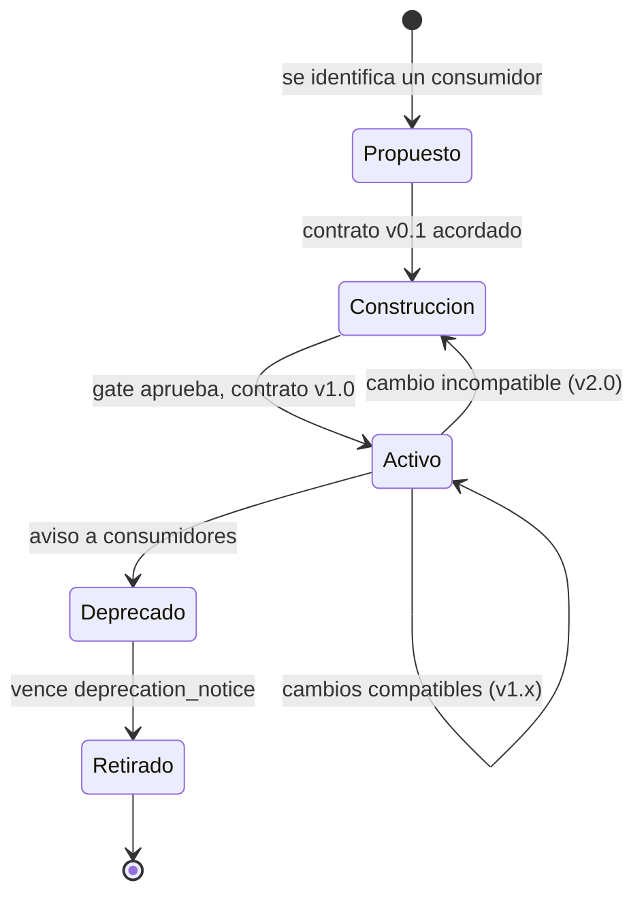

# Fase 5 · Productos de datos y contratos

**Duración típica:** 1 semana por producto
**Entregable:** cada activo de gold y feature bajo contrato verificable.
**Código:** [`contracts/`](../products/novamarket-commerce/contracts/) ·
[`contracts.py`](../governance/faro_governance/contracts.py)

## Qué convierte una tabla en un producto

Una tabla en gold con buen nombre y buena documentación sigue sin ser un producto de
datos. Le falta lo que hace que alguien pueda construir encima con confianza:

- **Quién responde** cuando algo falla.
- **Con qué frescura** llega el dato, y qué pasa si no llega.
- **Cuál es el grano**, sin tener que deducirlo de un `GROUP BY`.
- **Cuánto tiempo** se conserva.
- **Qué ocurre si cambia**, y con cuánto aviso.

Eso es el contrato. Y la propiedad que lo distingue de la documentación es que **cada
campo se verifica automáticamente**. Lo que no se pueda verificar no debería estar
escrito ahí.

## Anatomía

```yaml
metadata:
  name: dmt_sales_daily
  version: 1.2.0              # semver: el mayor sube con cada cambio incompatible
  owner: equipo-comercial@novamarket.cl
  steward: ana.morales@novamarket.cl

spec:
  asset: novamarket-data-prod-c3d4.commerce_gold.dmt_sales_daily
  layer: GOLD
  grain: [sale_date, product_key]
  freshness: { max_delay: P1D, schedule: "0 6 * * *" }
  retention: P5Y
  consumers:
    - equipo-finanzas@novamarket.cl
    - agente-analitica-sa@novamarket-data-prod-c3d4.iam.gserviceaccount.com
  deprecation_notice: P30D
  schema:
    - name: net_sales_amount
      type: NUMERIC
      required: true
      classification: INTERNAL
      description: Monto neto vendido, excluyendo ordenes canceladas.
```

Qué verifica el motor sobre cada campo:

| Campo | Verificación | Severidad si falla |
|---|---|---|
| `owner`, `grain`, `freshness`, `retention` | están presentes | BLOCK |
| `schema[].name` | la columna existe en el activo | BLOCK |
| `schema[].type` | coincide con el tipo real | BLOCK si es incompatible, WARN si es ampliación |
| `schema[].classification` | no contradice al clasificador de privacidad | BLOCK si declara de menos |
| `grain` | todas las columnas del grano existen | BLOCK |
| columnas no declaradas | están en el contrato | WARN |

## Los tres casos que importan

### Columna eliminada

```
[BLOCK] dmt_sales_daily.net_sales_amount  (contract.breaking_change)
   El contrato promete la columna 'net_sales_amount' y el activo no la expone.
   -> Restaurar, o publicar version mayor del contrato y notificar a
      equipo-finanzas@novamarket.cl, agente-analitica-sa@...
```

El mensaje **nombra a los consumidores**. Es la diferencia entre un error de validación
y una decisión informada: quien lee ese mensaje sabe a quién le va a romper el
dashboard, y eso cambia lo que hace a continuación.

### Cambio de tipo: dos casos distintos

```python
WIDENING_CASTS = {
    ("INT64", "NUMERIC"), ("INT64", "FLOAT64"),
    ("DATE", "DATETIME"), ("DATETIME", "TIMESTAMP"), ...
}
```

`INT64 → NUMERIC` no rompe a nadie: el valor sigue cabiendo. Se marca como
`contract.type_drift` con severidad WARN, porque lo que quedó desactualizado es el
contrato, no el dato.

`NUMERIC → STRING` sí rompe: toda consulta que sume esa columna deja de funcionar.
BLOCK.

Distinguir ambos casos es lo que evita que el equipo aprenda a ignorar las advertencias
del gate.

### Subclasificación

```
[BLOCK] dmt_customer_daily.customer_email  (contract.under_classified)
   El contrato declara 'customer_email' como INTERNAL pero se detecto
   Dato de contacto (CONFIDENTIAL, confianza 0.9).
   -> Reclasificar a CONFIDENTIAL y aplicar el policy tag 'person.contact'.
```

Importa el **sentido** del desacuerdo. Declarar de menos es el riesgo real: un dato
personal viajando como si fuera público. Declarar de más es conservador y sólo se
informa.

Cuando el clasificador se equivoca —ocurre— la salida es documentar la excepción en el
contrato, no bajar el umbral. Una excepción explícita es auditable; un umbral relajado
apaga el control para todos los casos.

## Detección de cambios incompatibles entre versiones

[`diff_contracts`](../governance/faro_governance/contracts.py) compara el contrato de la
rama contra el de la rama base y lista lo que rompe:

```python
breaking = diff_contracts(contrato_en_main, contrato_en_la_rama)
# ["columna eliminada: net_sales_amount",
#  "tipo incompatible en order_quantity: INT64 -> STRING",
#  "cambio de grano: ['sale_date', 'product_key'] -> ['sale_date']"]
```

Si hay cambios incompatibles y la versión mayor no subió, el gate bloquea. Es lo que
convierte el número de versión en información confiable en lugar de un adorno que nadie
actualiza.

El cambio de grano merece una mención aparte: es el más peligroso de los tres porque no
rompe ninguna consulta. Pasar de `[sale_date, product_key]` a `[sale_date]` deja todo
funcionando y duplica silenciosamente los montos de cualquier consumidor que hacía un
join por producto. Se descubre en el cierre de mes.

## Contratos para machine learning

Una tabla de features necesita metadatos que una tabla analítica no:

```yaml
ml:
  label_column: is_churned_flag
  label_horizon: P90D
  feature_windows: [P30D, P90D]
  point_in_time_correct: true
  excluded_from_features:
    - customer_key   # identificador: no es una señal, es una llave
```

Sin esto, un modelo entrenado hoy no se puede auditar en seis meses: nadie recuerda qué
ventana se usó ni por qué. `excluded_from_features` es la que más se agradece: evita que
alguien incluya la clave del cliente como variable y obtenga un modelo que memoriza en
lugar de generalizar.

## Base de licitud

Para productos cuyo grano es la persona —aunque sea seudonimizada:

```yaml
legal_basis:
  purpose: Segmentacion de clientes para campanias de retencion.
  basis: interes_legitimo
  regulation: Ley 21.719 Art. 13
  opt_out_supported: true
```

No es decorativo. Es lo que se le muestra a la autoridad si pregunta por qué existe esa
tabla, y lo que permite responder una oposición al tratamiento sin abrir un proyecto.

Que esté en el contrato y no en un documento aparte tiene una consecuencia práctica:
vive junto al código, se revisa en el mismo merge request y no puede quedar desactualizado
respecto de lo que la tabla efectivamente hace.

## El catálogo se genera, no se mantiene

Un catálogo que alguien tiene que actualizar a mano está desactualizado desde la segunda
semana. Los tres niveles de metadato que aquí se mantienen solos:

1. **En BigQuery**: Dataform escribe descripciones y policy tags al materializar. Están
   en `INFORMATION_SCHEMA` sin que nadie los copie.
2. **En el repositorio**: los contratos son archivos versionados, revisados en el mismo
   PR que el código que los cumple.
3. **En el portal**, si el cliente tiene uno: `catalog-info.yaml` para Backstage o
   equivalente, generado desde los contratos.

## Ciclo de vida de un producto



**El contrato se acuerda antes de construir.** Es la parte que se salta siempre y la que
más ahorra: discutir el grano y la frescura con el consumidor toma una reunión y evita
reconstruir la tabla dos veces.

**Deprecar no es borrar.** Durante `deprecation_notice` la tabla sigue viva y los
consumidores migran. El día que vence, se retira. Sin ese período, deprecar es sinónimo
de romper.

## Errores típicos

**Escribir el contrato después de la tabla.** Se convierte en una transcripción del
esquema en vez de un acuerdo, y pierde su función.

**Contratos que prometen lo que no se puede cumplir.** `max_delay: PT1H` sobre un
pipeline que corre diario es una promesa que va a fallar todos los días hasta que
alguien desactive la alerta.

**No listar los consumidores.** Es el campo que hace accionable el mensaje de cambio
incompatible. Sin él, el gate dice "esto rompe consumidores" y nadie sabe a quién avisar.

**Versionar por fecha.** `2026-09-16` no dice si el cambio rompe algo. Semver sí, y es
lo que el gate puede verificar.

---

Anterior: [Fase 4 · Gobierno como código](06-fase-4-gobierno-como-codigo.md) ·
Siguiente: [Fase 6 · Consumo: ML y agentes](08-fase-6-consumo-ml-y-agentes.md)
